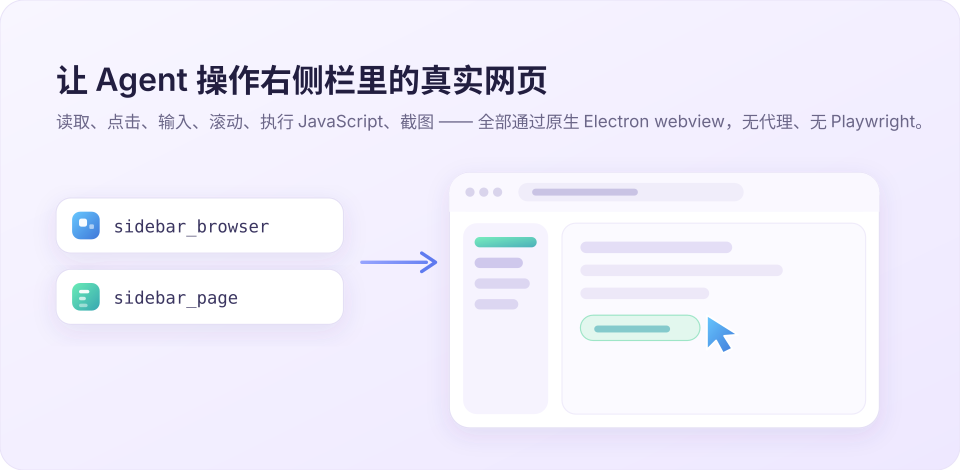

# 侧栏浏览器 Agent 控制（dsh-sidebar-browser-agent）

给 DeepSeek Harness 右侧栏的**原生浏览器**加上 Agent 可操作能力。

## 做什么

- 管理右侧栏浏览器标签页：`sidebar_browser`（status / list / open / navigate / reload / focus / close）。
- 操作真实页面：`sidebar_page`（read 文本 / 交互元素 / HTML、click、type、press、scroll、wait、eval、screenshot）。
- 全原生：直接调用 Electron `<webview>` 的 `executeJavaScript`、`sendInputEvent`、`capturePage`、`loadURL` —— 不使用 Playwright/Puppeteer、不注入代理、不重写页面。
- 截图以图片附件返回给模型；配置页可开关工具、允许 eval / 原生输入、设置域名白名单。

安装：`dsh plugin --profile <profile> add dsh-sidebar-browser-agent`（要求 DSH `>=0.2.2-rc.1 <0.3.0`）。

## 限制

- 只操作 **DSH 右侧栏原生浏览器**，不控制系统 Chrome/Safari，也不是无头浏览器。
- 页面内容操作需要 **DSH Desktop**（Electron 原生 webview）；Web 版只能管理标签页。
- 截图仅当调用会话可见时可用；会话隐藏时截图会返回错误。
- guest 调用有超时：页面脚本 25s、导航 20s；页面卡死会返回错误而不是挂起，必要时重载标签页。
- 受 profile 配置约束：Host 可关闭工具入口、禁止 eval / 原生输入、限制允许访问的域名。
- 只能访问宿主侧栏浏览器允许的 HTTP(S) 页面，地址栏规则之外的目标不可达。

变更记录见 [CHANGELOG.md](CHANGELOG.md)。
